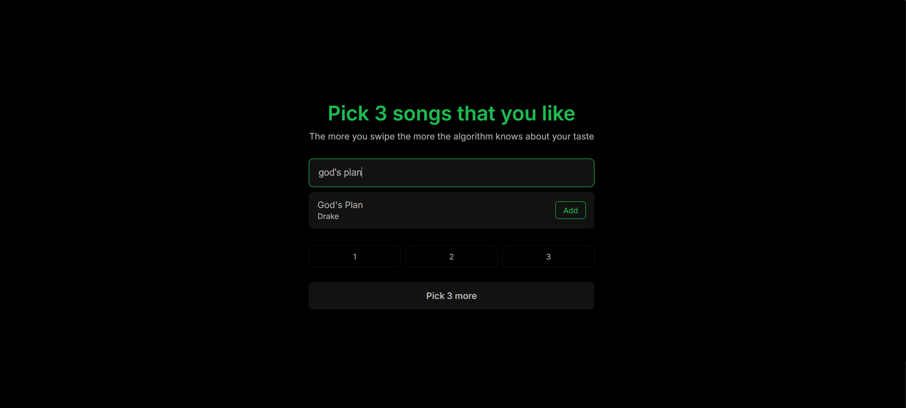
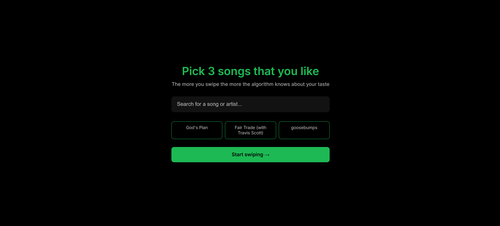
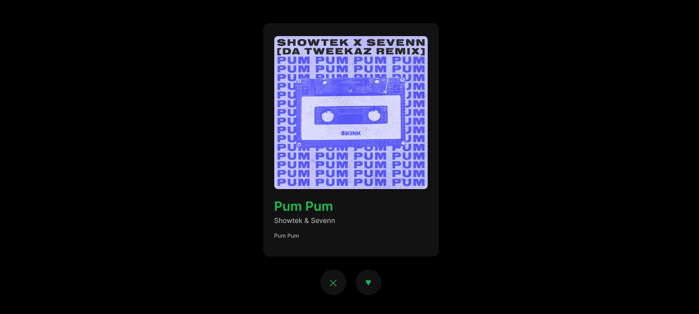

# SpotifyxTinder 

A full-stack music recommendation web app: pick 3 songs you like, then swipe through recommendations Tinder-style. Every like or dislike refines what the algorithm suggests next.


| Search | Selection | Swipe |
|---|---|---|
|  |  |  |

| Swipe right | Swipe left |
|---|---|
|  |  |

## Features

- Song and artist search over a dataset of 1.2M+ tracks
- Onboarding: choose 3 songs you like
- Swipe interface: like (right) or dislike (left) each recommendation
- Album artwork fetched from Apple Music (iTunes Search API)
- Responses in well under a second

## How it works

1. **Data**: two Kaggle datasets (see [Data](#data)) are merged into `dataset_merged_raw.csv`. At startup, the backend cleans and deduplicates them and loads the result into a database (indexed for fast search).
2. **Features**: each track is described by 9 audio features (`danceability`, `energy`, `loudness`, `speechiness`, `acousticness`, `instrumentalness`, `liveness`, `valence`, `tempo`), standardized with `StandardScaler` so that features on large scales (`tempo`, `loudness`) do not dominate the distance.
3. **Recommendation**: the next song is the unseen track with the smallest Euclidean distance to any song you liked (a nearest-neighbour search, K=1, computed with SciPy's `cdist`). Songs you disliked or already saw are excluded.
4. **Performance**: the lookup and distance computation take roughly 20 ms per swipe. Loading and preparing the data takes about 4 s once, at startup. The slowest step is the artwork request to Apple Music (~0.7 s), so the next song is prepared in the background.

## Tech stack

| Layer | Technologies |
|---|---|
| Frontend | React, Vite |
| Backend | Python, Flask, SQLAlchemy |
| Data / ML | Pandas, NumPy, SciPy, scikit-learn |

## Getting started

Tested with Python 3.12.7 and Node v24.19.0.

```bash
git clone https://github.com/nizarouita/SpotifyxTinder.git
cd SpotifyxTinder
```

**1. Backend** (start it first)

```bash
cd src/backend
python -m venv venv
source venv/bin/activate        # Windows: venv\Scripts\activate
pip install -r requirements.txt
python main.py
```

The API runs on http://127.0.0.1:5000. On the first launch it prepares the data (about 4 seconds).

**2. Frontend**

```bash
cd src/frontend
npm install
npm run dev
```

Open http://localhost:5173. The Vite dev server proxies `/api` requests to the backend, so no extra configuration is needed.

## Project structure

```
src/
├── backend/
│   ├── main.py                  # Flask app and API routes
│   ├── recommender.py           # Nearest-neighbour recommendation
│   ├── data.py                  # Data cleaning, deduplication, scaling
│   ├── data.ipynb
│   ├── models.py                # SQLAlchemy models
│   ├── config.py
│   └── dataset_merged_raw.csv   # Merged source datasets
└── frontend/
    └── src/                     # React components, hooks, API client
docs/
```

## Data

The dataset is built by merging two public Kaggle datasets:

- [Spotify Tracks Dataset](https://www.kaggle.com/datasets/maharshipandya/-spotify-tracks-dataset)
- [Spotify 1.2M+ Songs](https://www.kaggle.com/datasets/rodolfofigueroa/spotify-12m-songs)

All data belongs to its original authors. Check each dataset's license on its Kaggle page. Album artwork is retrieved from Apple Music via the iTunes Search API.

## Limitations and future work

- Only the single closest neighbour is used, so recommendations tend to cluster around one liked song.
- Dislikes only exclude songs; they do not push recommendations away from similar tracks.
- No evaluation metric yet for recommendation quality.
- No final results screen summarizing the recommendations.
- Artwork depends on an external API (~0.7 s latency, outside of my control).

## License

Code released under the [MIT License](LICENSE).
